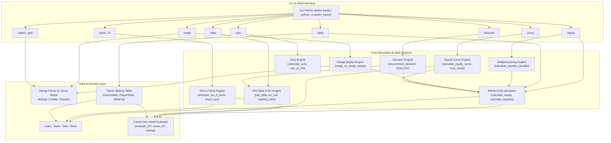

# 🃏 Poker Monte Carlo Equity Simulator

[](https://www.python.org/downloads/)
[](LICENSE)
[](tests/)
[](https://github.com/psf/black)
[](https://github.com/astral-sh/ruff)
[](https://mypy-lang.org/)

A high-performance, enterprise-grade **Monte Carlo poker equity simulator and decision engine** built from scratch in Python. Supports Texas Hold'em hand evaluation, range vs range equity, dead-card blocker modeling, pot odds math, drawing outs, GTO action recommendations, run-it-twice variance reduction, street-by-street equity trajectories, and terminal 13×13 range grid matrix visualizations.

> **Why Monte Carlo?** Exact equity enumeration requires evaluating every possible board runout — up to 1.7 million combinations for a single preflop matchup. Monte Carlo simulation achieves near-exact accuracy in milliseconds by sampling thousands of random runouts and converging on true equity with rigorous 95% confidence intervals.

---

## ✨ Features

- **Blazing-Fast Hand Evaluation Engine** — Custom $O(1)$ Cactus Kev lookup table evaluator with prime products and bitwise rank encodings. Evaluates 5, 6, and 7-card hands with rich `HandResult` objects or ultra-fast integer scoring (`score_7`) capable of millions of evaluations per second.
- **Monte Carlo Simulation** — Configurable iterations, deterministic RNG seeding, real-time progress callbacks, and early convergence stopping when confidence intervals narrow below a target threshold.
- **Multiprocessing Support** — High-throughput parallel simulation across multiple CPU worker cores for large-scale analysis.
- **Advanced Range Parser** — Express complex poker ranges with intuitive syntax: pairs (`AA`, `TT+`, `99-77`), suited hands (`AKs`, `AJs+`, `T9s-76s`), offsuit hands (`AKo`, `AQo+`), weighted combos (`AA:0.8, KK:0.5`), percentile shorthands (`top10%`), and 28+ pre-built position opening/defense presets (`BTN_OPEN`, `BB_VS_BTN_DEFENSE`).
- **Range vs Range Equity** — Full range-vs-range and hand-vs-range simulations with dead-card blocker deduction and top-$N$ combo equity breakdowns.
- **Pot Odds & EV Math** — Mathematical break-even pot odds %, EV of calling, direct vs future EV, required future bets, implied odds, and reverse implied odds.
- **Drawing Outs Engine** — Unseen card enumeration, villain hand discounting, Rule of 2 and Rule of 4 (standard and adjusted), exact turn and river probabilities, and categorized outs by made hand rank.
- **Strategic Decision Engine** — Recommends `FOLD`, `CHECK`, `CALL`, `RAISE`, or `ALL_IN` by computing expected value tables across all legal options, incorporating stack-to-pot ratio (SPR) and fold equity.
- **Run-It-Twice & Run-It-N-Times** — All-in multi-board variance reduction modeling, scoop/split probabilities, expected payouts, and exact combinatorial turn enumeration ($946$ scenarios).
- **Equity Curve Trajectory** — Street-by-street equity progression (Preflop $\to$ Flop $\to$ Turn $\to$ River), lead change tracking, turning point detection, bad beat analysis, and next-street card distributions.
- **13×13 Range Grid Visualizer** — Terminal-based ANSI color-coded starting hand matrix with multiple cell display modes (`hands`, `weights`, `combos`, `heat`), blocker dead card filtering, and two-range comparison matrices.
- **Interactive Table Simulator** — Heads-up poker table engine with blinds, stacks, side pots, automatic dealing, interactive REPL loop, pre-scripted action sequences, and live Monte Carlo recommendations.
- **Polished CLI Suite** — 9 comprehensive subcommands, ANSI color themes, pure JSON output mode for shell piping, and direct module invocation (`python -m poker_equity`).

---

## 🏗️ Architecture



---

## 📦 Installation

### Prerequisites
- Python 3.11 or higher
- `pip`

### Install from Source

```bash
# Clone repository
git clone https://github.com/SheehanD1/Poker-Monte-Carlo-Equity-Sim.git
cd Poker-Monte-Carlo-Equity-Sim

# Install package in editable development mode
pip install -e ".[dev]"
```

### Verify Installation

```bash
# Run test suite
python -m pytest

# Run CLI help
poker-equity --help
```

---

## 🚀 Quick Start: Python API

The `poker_equity` package exports a rich, type-annotated public API:

### 1. Card Primitives & Hand Evaluation

```python
from poker_equity import Card, Deck, evaluate_5, evaluate_7, score_7

# Parse cards using standard notation
hero_cards = [Card.from_str("Ah"), Card.from_str("Kh")]
board = [Card.from_str(c) for c in ["Qh", "Jh", "Th", "2c", "3d"]]

# Detailed hand evaluation
result = evaluate_7(hero_cards + board)
print(result)             # "Royal Flush"
print(result.rank.label)   # "Royal Flush"

# Fast integer score for Monte Carlo loops (~5x faster)
score = score_7(hero_cards + board)
print(score)              # 7462 (absolute highest rank)
```

### 2. Monte Carlo Equity Simulation

```python
from poker_equity import Card, calculate_equity, calculate_equities

hero = [Card.from_str("Ah"), Card.from_str("Kh")]
villain = [Card.from_str("Qc"), Card.from_str("Qd")]
board = [Card.from_str("2h"), Card.from_str("7h"), Card.from_str("8c")]

# Calculate heads-up equity with 50,000 simulations
result = calculate_equity(hero, villain, board=board, num_sims=50_000, seed=42)
print(f"Hero Equity: {result.equity:.2%}")   # ~54.6%
print(f"Hero Win Rate: {result.win_pct:.2%}")
print(f"95% CI: [{result.ci_lower:.4f}, {result.ci_upper:.4f}]")
```

### 3. Range Parsing & Range vs Range Equity

```python
from poker_equity import Range, range_vs_range_equity

btn_range = Range.from_str("TT+, AJs+, KQs, AKo")
bb_range = Range.from_preset("BB_VS_BTN_DEFENSE")

# Range vs Range on wet flop
res = range_vs_range_equity(
    hero_range=btn_range,
    villain_range=bb_range,
    board_cards=[Card.from_str("Jh"), Card.from_str("Th"), Card.from_str("9c")],
    num_sims=10_000,
    seed=42,
)
print(f"BTN Range Equity: {res.hero_equity:.2%}")
print(f"BB Range Equity : {res.villain_equity:.2%}")
```

### 4. Pot Odds, EV & Decision Support

```python
from poker_equity import pot_odds, is_profitable_call, ev_call, recommend_decision

# Facing a $50 bet into a $100 pot (Hero has 35% equity)
odds = pot_odds(pot=100.0, call_amount=50.0)
print(f"Required Pot Odds: {odds:.1%}")  # 33.3%

ev = ev_call(equity=0.35, pot=100.0, call_amount=50.0)
print(f"Call EV: {ev:+.2f} chips")       # +2.50 chips

# Full decision recommendation
decision = recommend_decision(
    equity=0.35,
    pot=100.0,
    bet_to_call=50.0,
    hero_stack=150.0,
)
print(f"Recommended Action: {decision.action.value}")  # 'call'
```

### 5. Run-It-Twice & Variance Reduction

```python
from poker_equity import exact_run_it_twice_turn, simulate_run_it_twice

# Exact turn enumeration (evaluates all 946 remaining combinations)
exact_res = exact_run_it_twice_turn(
    hero=[Card.from_str("Ah"), Card.from_str("Kh")],
    villain=[Card.from_str("Qc"), Card.from_str("Qd")],
    board=[Card.from_str("2h"), Card.from_str("7h"), Card.from_str("8c"), Card.from_str("3d")],
)
print(f"Hero Equity: {exact_res.hero_equity:.2%}")
print(f"Variance Reduction: {exact_res.variance_reduction:.2f}%")
print(f"Split Pot Probability: {exact_res.split_pct:.2%}")
```

---

## 🖥️ Command-Line Interface (CLI)

The CLI offers 9 specialized subcommands. See the full [CLI User Guide & Reference Manual](docs/CLI_GUIDE.md) for detailed flag references, argument signatures, and advanced scripting examples.

### Quick Command Overview

| Subcommand | Aliases | Description |
|------------|---------|-------------|
| `equity` | - | Monte Carlo equity simulation (heads-up, multiway, postflop, dead cards, parallel). |
| `range` | - | Range vs range / hand vs range equity simulation with combo breakdowns. |
| `odds` | - | Pot odds, expected value (EV), break-even threshold, and implied odds. |
| `outs` | - | Outs calculation, villain discounting, Rule of 2/4, and categorized outs. |
| `decision` | - | GTO decision recommendation (`FOLD`, `CHECK`, `CALL`, `RAISE`, `ALL_IN`) with action EV table. |
| `table` | - | Interactive table simulator with betting rounds, side pots, and live recommendations. |
| `twice` | `rit`, `run-it-twice` | Run-It-Twice simulation, variance reduction, and exact turn enumeration. |
| `curve` | - | Street-by-street equity trajectory, turning points, ASCII sparklines, and next-street analysis. |
| `matrix` | `grid`, `matrix13` | ANSI 13×13 starting hand grid visualizer with blockers and range comparisons. |

---

### Terminal Visualizations

#### 1. 13×13 Range Grid Matrix (`poker-equity matrix`)

Visualizes starting hand selections across the canonical 13×13 grid:

```text
$ poker-equity matrix "QQ+, AKs" --board "Ah Kd 2s"

Range Matrix: QQ+, AKs
      A    K    Q    J    T    9    8    7    6    5    4    3    2  
   ┌──────────────────────────────────────────────────────────────────┐
 A │ AA*  AKs*  .    .    .    .    .    .    .    .    .    .    .   │
 K │  .   KK*   .    .    .    .    .    .    .    .    .    .    .   │
 Q │  .    .    QQ   .    .    .    .    .    .    .    .    .    .   │
 J │  .    .    .    .    .    .    .    .    .    .    .    .    .   │
 T │  .    .    .    .    .    .    .    .    .    .    .    .    .   │
 9 │  .    .    .    .    .    .    .    .    .    .    .    .    .   │
 8 │  .    .    .    .    .    .    .    .    .    .    .    .    .   │
 7 │  .    .    .    .    .    .    .    .    .    .    .    .    .   │
 6 │  .    .    .    .    .    .    .    .    .    .    .    .    .   │
 5 │  .    .    .    .    .    .    .    .    .    .    .    .    .   │
 4 │  .    .    .    .    .    .    .    .    .    .    .    .    .   │
 3 │  .    .    .    .    .    .    .    .    .    .    .    .    .   │
 2 │  .    .    .    .    .    .    .    .    .    .    .    .    .   │
   └──────────────────────────────────────────────────────────────────┘

  Range Summary: 14.0 / 1326 combos (1.06%) across 4 / 169 hands
    Pairs:    12.0 / 78 combos ( 15.4%) in  3/13 hands
    Suited:    2.0 / 312 combos (  0.6%) in  1/78 hands
    Offsuit:   0.0 / 936 combos (  0.0%) in  0/78 hands
    Blockers: [A♥ K♦ 2♠] (8.0 combos removed by blockers)
  Legend: Hands in range shown; [*] Partial weight; [.] Excluded
```

#### 2. Equity Curve Trajectory & Sparklines (`poker-equity curve`)

Tracks equity evolution street-by-street with ASCII sparklines:

```text
$ poker-equity curve "Ah Kh" "Qc Qd" -b "2h 7h 8c 3d 4s" --chart

Street-by-Street Equity Trajectory:
====================================================================
  [PREFLOP] Board: [None          ]
    Hero   :  46.2% [█████████░░░░░░░░░░░]  [Hole cards]
    Villain:  53.8% [███████████░░░░░░░░░]  [Hole cards]

  [FLOP   ] Board: [2h 7h 8c      ] (Hero Δ: +7.0%)
    Hero   :  53.2% [███████████░░░░░░░░░]  [Ace-high]
    Villain:  46.8% [█████████░░░░░░░░░░░]  [Pair of Queens]

  [TURN   ] Board: [2h 7h 8c 3d   ] (Hero Δ: -20.0%)
    Hero   :  33.2% [███████░░░░░░░░░░░░░]  [Ace-high]
    Villain:  66.8% [█████████████░░░░░░░]  [Pair of Queens]

  [RIVER  ] Board: [2h 7h 8c 3d 4s] (Hero Δ: -33.2%) [TURNING POINT]
    Hero   :   0.0% [░░░░░░░░░░░░░░░░░░░░]  [Ace-high]
    Villain: 100.0% [████████████████████]  [Pair of Queens]

Equity Spark Graph (Hero):
  100% |                                         
   80% |                                         
   60% |    ●46%      ●53%                       
   40% |                        ●33%             
   20% |                                  ●0%    
       +--------------------------------------------
       PREFLOP   FLOP      TURN      RIVER     
```

#### 3. Strategic Decision Engine (`poker-equity decision`)

Action EV comparison table with optimal action recommendation:

```text
$ poker-equity decision --hero "Ah Kh" --villain "Qc Qd" --board "2h 7h 8c" --pot 100 --call 50

Strategic Decision Recommendation
================================================================
Recommended Action: CALL
Expected Value    : +28.45 chips
Hero Equity       : 52.3%
Pot Odds          : 33.3%
Pot Size          : 100.00 chips (Cost to Call: 50.00)
Hero Stack        : 42.00 chips (SPR: 0.42)
Hole Cards        : Hero A♥ K♥ vs Villain Q♣ Q♦ | Board: 2♥ 7♥ 8♣
----------------------------------------------------------------
Action Expected Value (EV) Comparison:
Action     EV (chips)     Delta vs Best    Status          
----------------------------------------------------------------
CALL           +28.45 chips     0.00           ★ Recommended
FOLD            +0.00 chips   -28.45           Suboptimal
----------------------------------------------------------------
Analysis: All-in call is profitable (+28.45 EV). Hero equity (52.3%) meets/exceeds pot odds requirement (33.3%).
```

---

## 🧪 Testing & Quality Assurance

The codebase is rigorously tested with unit, property-based, performance, and end-to-end integration tests:

```bash
# Run the fast test suite (1,079 tests)
python -m pytest -m "not slow"

# Run end-to-end CLI integration tests
python -m pytest tests/test_e2e_cli.py

# Run with test coverage report
python -m pytest --cov=poker_equity --cov-report=term-missing

# Run linting and type checking
ruff check src/ tests/
mypy src/
```

### Test Suite Structure

| Test File | Focus Area | Test Count |
|---|---|---|
| `tests/test_card.py` | Card, Rank, Suit primitives, hashing, sorting | 76 |
| `tests/test_deck.py` | Deck shuffling, dealing, removal, RNG reproducibility | 35 |
| `tests/test_evaluator.py` | 5/6/7-card hand evaluators, tie-breaking | 59 |
| `tests/test_lookup.py` | Cactus Kev prime products, flushes, score lookup tables | 43 |
| `tests/test_simulation.py` | Monte Carlo simulations, heads-up and multiway equity | 35 |
| `tests/test_convergence.py` | Confidence intervals, early stopping convergence | 28 |
| `tests/test_parallel.py` | Multiprocessing worker pools and parallel chunking | 22 |
| `tests/test_range.py` | Range syntax parser, combo expansion, dead cards | 176 |
| `tests/test_range_equity.py`| Range vs range Monte Carlo simulations | 33 |
| `tests/test_breakdown.py` | Top-$N$ combo breakdowns and per-combo equities | 30 |
| `tests/test_presets.py` | Pre-built position ranges, percentiles, archetypes | 27 |
| `tests/test_weights.py` | Weighted ranges and fractional matrix mappings | 32 |
| `tests/test_odds.py` | Pot odds, break-even thresholds, EV, implied odds | 105 |
| `tests/test_outs.py` | Drawing outs, villain discounting, Rule of 2/4 | 41 |
| `tests/test_decision.py` | GTO decision recommendations, action EV comparisons | 34 |
| `tests/test_all_in.py` | Run-It-Twice, Run-It-N-Times, exact turn enumeration | 28 |
| `tests/test_equity_curve.py`| Equity trajectories, turning points, bad beats | 31 |
| `tests/test_game_state.py` | Table engine, betting rounds, blinds, side pots | 17 |
| `tests/test_cli.py` | Subcommand parsing, options, ANSI formatters, error handling | 159 |
| `tests/test_e2e_cli.py` | Process invocation (`python -m`), JSON purity, cross-tool pipelines | 70 |
| **Total** | **Comprehensive Test Suite** | **1,086 tests** |

---

## 📁 Repository Structure

```
Poker-Monte-Carlo-Equity-Sim/
├── docs/
│   └── CLI_GUIDE.md           # Comprehensive CLI user guide & reference manual
├── src/
│   └── poker_equity/
│       ├── __init__.py        # Public API (74 exports)
│       ├── __main__.py        # Direct package entry point (`python -m poker_equity`)
│       ├── card.py            # Card, Rank, Suit primitives
│       ├── deck.py            # Deck with shuffle, deal, remove, reset
│       ├── constants.py       # Card constants & parsing utilities
│       ├── hand_rank.py       # HandRank enum & HandResult dataclass
│       ├── evaluator.py       # 5/6/7-card evaluators (rich + fast scoring)
│       ├── lookup.py          # O(1) lookup tables (7,462 unique hand ranks)
│       ├── simulation.py      # Monte Carlo simulator & confidence intervals
│       ├── parallel.py        # Multiprocessing execution engine
│       ├── range.py           # Range parser, combos, & 13x13 matrix
│       ├── breakdown.py       # Combo breakdown & per-combo equity analysis
│       ├── presets.py         # Position ranges & percentile presets
│       ├── odds.py            # Pot odds, EV, & implied odds calculators
│       ├── outs.py            # Drawing outs & Rule of 2/4 engine
│       ├── decision.py        # Strategic decision recommendation engine
│       ├── all_in.py          # Run-It-Twice & exact turn enumeration
│       ├── equity_curve.py    # Street-by-street trajectory & swing analysis
│       ├── game_state.py      # Table engine, betting rounds, & side pots
│       └── cli.py             # 9 subcommands, ANSI color formatters, JSON export
├── tests/                     # 20 test files (1,086 test cases)
├── pyproject.toml             # Project metadata, CLI entry points, tool configurations
├── Makefile                   # Developer automation targets
├── LICENSE                    # MIT License
└── README.md                  # Project overview & quick start
```

---

## 📄 License

This project is licensed under the MIT License — see the [LICENSE](LICENSE) file for details.

---

## 👤 Author

**Sheehan Dandapat**

*Built with ♠️ ♥️ ♦️ ♣️*
